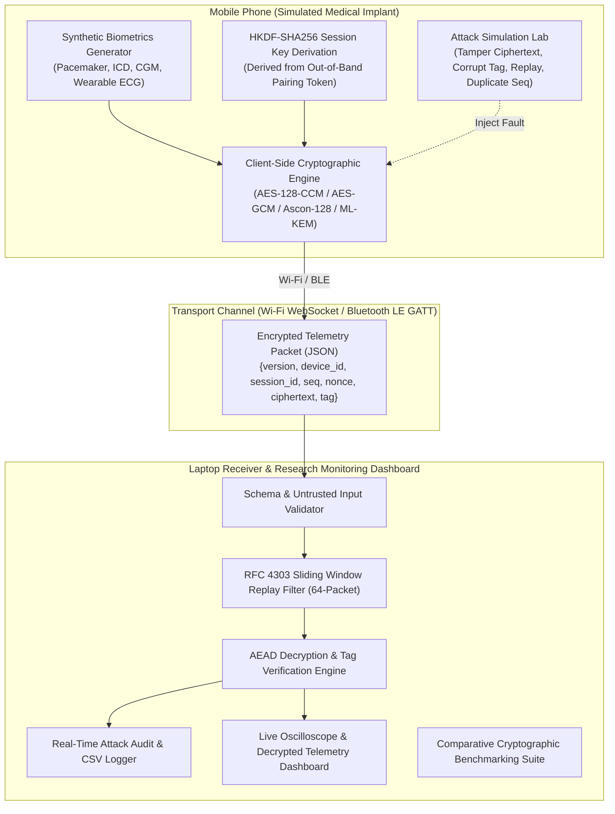

# SecureMed — Medical Device Cryptographic Communication Simulator

[](https://github.com/ShrisarveshV/SecureMed/actions/workflows/ci.yml)
[](https://codespaces.new/ShrisarveshV/SecureMed)
[](https://render.com/deploy?repo=https://github.com/ShrisarveshV/SecureMed)

SecureMed is an educational cybersecurity research simulator demonstrating authenticated cryptographic telemetry transmission between simulated implantable medical devices (such as pacemakers, ICDs, continuous glucose monitors, and wearable ECG monitors) and a monitoring receiver laptop.

> **EDUCATIONAL RESEARCH DISCLAIMER**: SecureMed is strictly a software cybersecurity research simulator operating on synthetic telemetry. It does **not** connect to real clinical devices, issue real medical stimulation commands, or use real patient health data.

---

## 1. System Architecture



---

## 2. Quick Start Guide

### Step 1: Start the Laptop Receiver
```bash
# Using Python
py run_server.py

# Or double-click the Windows batch launcher:
start_securemed.bat
```
The server binds to `0.0.0.0:8000` and displays:
- **Laptop Dashboard**: `http://localhost:8000`
- **Mobile Phone URL**: `http://<LAPTOP_LOCAL_IP>:8000/phone`
- **Scannable QR Code** (automatically generated)

### Step 2: Open the Mobile Phone Simulator
You do **not** need to install any app stores or compile APKs:
1. Ensure your phone is connected to the **same Wi-Fi network** (or phone mobile hotspot) as your laptop.
2. Open your phone camera and **scan the QR code** displayed on the laptop dashboard (`http://localhost:8000`).
3. Or type the URL in Chrome / Safari: `http://<LAPTOP_LOCAL_IP>:8000/phone`
4. The phone automatically receives the session ID and out-of-band pairing token.

### Step 3: Stream Encrypted Medical Telemetry
1. Select a simulated device:
   - **Pacemaker (`SIM-PM-001`)**: Heart rate (BPM), pacing pulse voltage, lead impedance, battery level.
   - **ICD Defibrillator (`SIM-ICD-002`)**: Ventricular rate, sensing amplitude, capacitor voltage.
   - **Glucose Monitor (`SIM-CGM-003`)**: Glucose mg/dL, trend direction, sensor current.
   - **Wearable ECG (`SIM-ECG-004`)**: Real-time Lead-II electrical cardiac waveform samples.
2. Select an encryption algorithm (`AES-128-CCM`, `AES-128-GCM`, `AES-256-GCM`, `Ascon-AEAD128`, or `ML-KEM-768-AES-GCM`).
3. Tap **"START TELEMETRY STREAM"**.
4. Observe local client-side encryption on the phone, live transmission, and real-time decryption on the laptop receiver dashboard.

---

## 3. Cryptographic Engine Specification

SecureMed implements a modular authenticated encryption with associated data (AEAD) architecture designed for resource-constrained medical telemetry:

### A. Primary Algorithm: AES-128-CCM (BLE Default Standard)
- **Mode**: Counter with CBC-MAC (NIST SP 800-38C / RFC 3610).
- **Key Size**: 128 bits.
- **Nonce Size**: 12 bytes (96 bits) unique per message under the same key.
- **MAC Tag**: 16 bytes (128 bits) providing high cryptographic integrity.
- **Client Implementation**: Pure JavaScript implementation in `static/phone.html` with bit-for-bit interoperability with Python `cryptography.hazmat.primitives.ciphers.aead.AESCCM`.

### B. Candidate Comparison Algorithms
| Algorithm | Key Size | Nonce Size | MAC Tag | Target Medical Profile |
| :--- | :--- | :--- | :--- | :--- |
| **AES-128-CCM** | 128 bits | 12 bytes | 16 bytes | BLE-connected pacemakers & neurostimulators |
| **AES-128-GCM** | 128 bits | 12 bytes | 16 bytes | High-throughput wearable multi-lead ECG streaming |
| **AES-256-GCM** | 256 bits | 12 bytes | 16 bytes | Long-term implantable devices requiring 30+ year security |
| **Ascon-AEAD128** | 128 bits | 16 bytes | 16 bytes | NIST SP 800-232 Lightweight Cryptography standard for micro-sensors |
| **ML-KEM-768 + AES-GCM** | 256 bits | 12 bytes | 16 bytes | Post-quantum hybrid key encapsulation (NIST FIPS 203) |

### C. Authenticated Associated Data (AAD) Canonicalization
To guarantee that header metadata cannot be spoofed, altered, or spliced in transit, all protocol fields are bound to the ciphertext using canonical AAD:
$$\text{AAD} = \text{"VER:1|DEV:SIM-PM-001|SES:SES-1718000|SEQ:42|ALG:AES-128-CCM"}$$
If an adversary tampers with the device ID, sequence number, or session ID in the JSON wrapper, the receiver detects a MAC mismatch and rejects the packet with `AUTHENTICATION_FAILED`.

### D. Out-of-Band Optical Key Bootstrap (No Plaintext Keys on the Wire)
1. The laptop receiver generates an ephemeral 128-bit pairing token.
2. The pairing token is displayed optically via a QR code on the laptop monitor.
3. The phone camera captures the token over the physical out-of-band visual channel.
4. Both devices independently derive the symmetric session key using **HKDF-SHA256**:
   $$K_{\text{session}} = \text{HKDF-Expand}(\text{PRK}=\text{HKDF-Extract}(\text{token}), \text{info}=\text{"SecureMed-SessionKey"}, \text{length}=L)$$
5. **Security Guarantee**: Raw cryptographic keys are **never transmitted in plaintext** across the network. Eavesdroppers intercepting Wi-Fi or WebSockets cannot decrypt the telemetry.

### E. Post-Quantum Hybrid Key Encapsulation (ML-KEM-768)
1. Receiver generates a Kyber768 / ML-KEM-768 keypair $(PK, SK)$ conforming to NIST FIPS 203.
2. Sender encapsulates a 32-byte shared secret using $PK$: $(SS_{\text{client}}, CT_{\text{kem}}) = \text{ML-KEM-768.Encaps}(PK)$.
3. Sender transmits only the ciphertext $CT_{\text{kem}}$ (1088 bytes) to the laptop receiver.
4. Receiver decapsulates: $SS_{\text{receiver}} = \text{ML-KEM-768.Decaps}(SK, CT_{\text{kem}})$.
5. Both endpoints derive the 256-bit symmetric session key using HKDF-SHA256.

---

## 4. Replay Protection & Attack Simulation Lab

### RFC 4303 Sliding Window Bitmap
To protect against replay attacks without dropping legitimate out-of-order packets common over wireless links, the receiver implements an IPsec-style 64-packet sliding window:
- **Duplicate Sequence Number**: Replayed packets with a sequence number already recorded in the active bitmap are rejected with `REPLAY_DETECTED: Duplicate sequence number already accepted`.
- **Stale Sequence Number**: Packets arriving with a sequence number older than the trailing edge of the window ($SEQ < SEQ_{\text{max}} - 64$) are rejected with `REPLAY_DETECTED: Stale sequence number`.
- **Tolerated Out-of-Order Packets**: Legitimate out-of-order packets within the 64-packet window that have not been seen before are accepted safely.

### Controlled Attack Simulator (Tested Safely on Synthetic Packets)
The mobile phone includes dedicated fault-injection buttons:
1. **Tamper Ciphertext**: Flips bit `0xFF` in the raw ciphertext before transmission. Receiver catches tag mismatch and rejects with `AUTHENTICATION_FAILED`.
2. **Corrupt Auth Tag**: Alters a byte of the 16-byte MAC tag. Receiver rejects with `AEAD Tag Mismatch`.
3. **Replay Last Packet**: Re-transmits an exact previously accepted packet. Replay filter detects duplicate sequence number and rejects.
4. **Duplicate Seq #**: Emits fresh telemetry reusing an accepted sequence number. Replay filter rejects.
5. **Malformed Packet**: Emits invalid protocol versions and corrupted Base64 strings to verify untrusted input schema sanitization.
6. **Drop Connection**: Closes and reconnects socket to test session separation and renegotiation.

---

## 5. Measured Cryptographic Performance Benchmarks

Measured on host architecture using identical message payloads (352 bytes JSON telemetry), $N=300$ iterations:

| Algorithm | Key / Tag Size | Enc Mean (μs) | Dec Mean (μs) | Wire Packet Size | Overhead | Throughput |
| :--- | :--- | :--- | :--- | :--- | :--- | :--- |
| **AES-128-CCM** | 128b / 16B | 6.37 ± 2.30 | 4.82 ± 0.27 | 705 B | +100.3% | 146,793 ops/s |
| **AES-128-GCM** | 128b / 16B | 7.35 ± 0.94 | 6.25 ± 0.64 | 705 B | +100.3% | 130,492 ops/s |
| **AES-256-GCM** | 256b / 16B | 6.78 ± 1.60 | 5.56 ± 0.49 | 705 B | +100.3% | 140,509 ops/s |
| **Ascon-AEAD128** | 128b / 16B | 3459.91 ± 431.24 | 3169.71 ± 516.93 | 715 B | +103.1% | 289 ops/s |
| **ML-KEM-768-AES-GCM** | 256b / 16B | 4.39 ± 0.64 | 3.93 ± 0.16 | 712 B | +102.3% | 217,030 ops/s |

**Post-Quantum Key Establishment (ML-KEM-768)**:
- Public Key: 1184 Bytes | Ciphertext: 1088 Bytes
- Encapsulation: 6,657.8 μs | Decapsulation: 9,051.4 μs

> **Engineering Note**: Benchmarks represent host CPU execution. Real clinical implantable pacemakers use ultra-low-power dedicated hardware ASIC coprocessors; battery life cannot be inferred from laptop benchmarks.

You can execute the live benchmark directly from the dashboard by clicking **"Run Benchmark"**, or via CLI:
```bash
py crypto_engine/benchmark.py
```

---

## 6. Bluetooth Low Energy (Mode B) Specification

### Custom Medical GATT Profile
- **Service UUID**: `6E400001-B5A3-F393-E0A9-E50E24DCCA9E`
- **Telemetry TX Characteristic (Phone -> Laptop)**: `6E400002-B5A3-F393-E0A9-E50E24DCCA9E` (Write / Notify)
- **Status ACK Characteristic (Laptop -> Phone)**: `6E400003-B5A3-F393-E0A9-E50E24DCCA9E` (Read / Indicate)

### Hardware State Verification
SecureMed verifies real Bluetooth hardware via `bleak`. If the laptop or phone Bluetooth radio is powered off or unavailable, the dashboard explicitly reports:
`Bluetooth LE Status: Radio Off / Unavailable — Fallback to Wi-Fi mode active`
It never displays a successful Bluetooth connection unless one has physically been established.

---

## 7. Automated Test Suite

All 23 comprehensive unit and integration tests can be executed with:
```bash
py -m unittest discover tests
```

### Verified Test Cases:
1. `test_01_all_ciphers_roundtrip`: Verifies AES-128-CCM, AES-128-GCM, AES-256-GCM, and Ascon-AEAD128 encryption/decryption round trips.
2. `test_02_rejection_of_tampered_ciphertext`: Bit-flip in ciphertext causes immediate verification rejection.
3. `test_03_rejection_of_tampered_tag`: Bit-flip in authentication tag causes immediate verification rejection.
4. `test_04_wrong_key_rejection`: Unpaired receiver cannot decrypt packets with an incorrect key.
5. `test_05_nonce_uniqueness`: Verifies 100% unique nonces across 100 consecutive messages to prevent IV reuse.
6. `test_06_replay_detection_duplicate_sequence`: Detects duplicate sequence numbers.
7. `test_07_replay_detection_stale_packet`: Detects packets falling behind the 64-packet sliding replay window.
8. `test_08_session_separation`: Rejects spoofed or cross-session packets.
9. `test_09_invalid_packet_handling`: Validates type safety, Base64 encoding, and field bounds.
10. `test_10_end_to_end_pipeline_with_tamper_attack`: Tests full receiver pipeline against attacks.
11. `test_11_post_quantum_ml_kem_768_derivation`: Validates NIST FIPS 203 ML-KEM-768 with HKDF-SHA256 key derivation.
12. `test_12_synthetic_telemetry_generators`: Verifies realistic synthetic data generation for all 4 devices.
13. `test_13_csv_logging_verification`: Verifies CSV log generation and column conformance.
14. `test_14_disconnection_and_reconnection_session_resilience`: Verifies session rekeying and rejection of stale sessions.
15. `test_15_all_ciphers_interoperability_end_to_end`: Tests all 4 ciphers through the end-to-end receiver pipeline.
16. `test_16_ble_adapter_diagnostics`: Validates BLE GATT UUIDs and diagnostic reporting.
17. `test_17_comparative_benchmark_metrics`: Verifies reproducible benchmark measurement.

---

## 8. Network Configuration & Troubleshooting

| Issue | Likely Cause | Solution |
| :--- | :--- | :--- |
| Phone cannot connect to laptop IP | Devices on different networks or guest isolation active | Connect both laptop and phone to the same Wi-Fi network, or turn on your phone's personal mobile hotspot and connect your laptop to it. |
| Connection refused on port 8000 | Windows Firewall blocking inbound connections | Allow python.exe through Windows Defender Firewall, or run: `netsh advfirewall firewall add rule name="SecureMed" dir=in action=allow protocol=TCP localport=8000` |
| Bluetooth Radio Off | Bluetooth disabled in OS | Enable Bluetooth in Windows Settings. If laptop lacks Bluetooth hardware, Wi-Fi Mode operates automatically with 100% functional parity. |
| AEAD Tag Mismatch | Tampered ciphertext or wrong pairing PIN | Verify pairing token by re-scanning the QR code or clicking "Reset" on the dashboard. |

---

## 9. Academic License & Citation

SecureMed is released for open academic research and university demonstrations in medical device cybersecurity.
